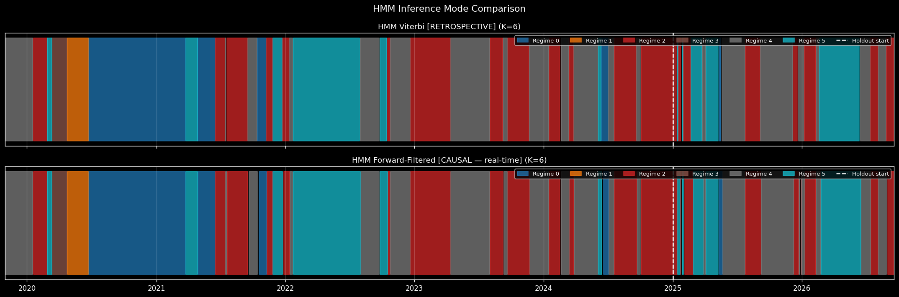
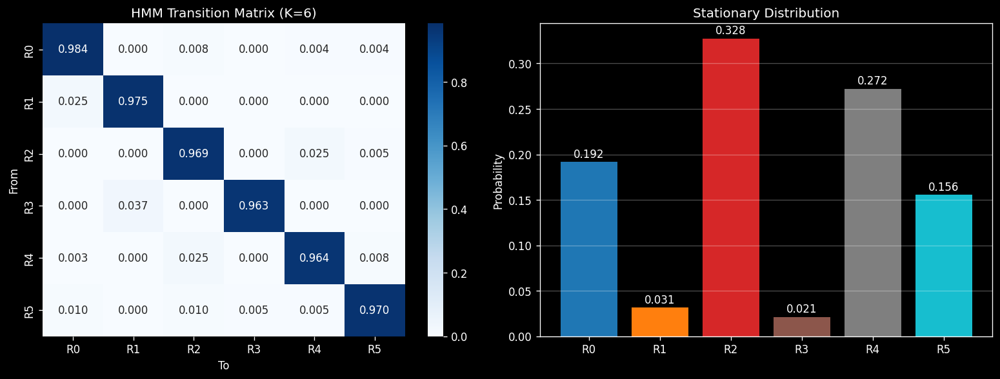
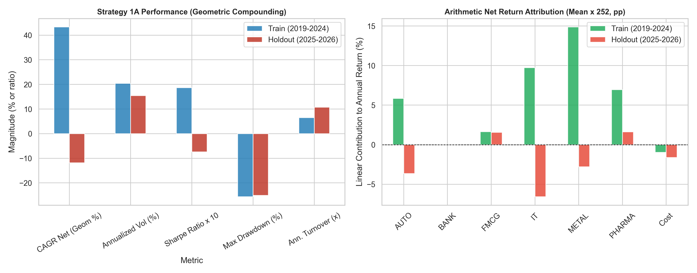
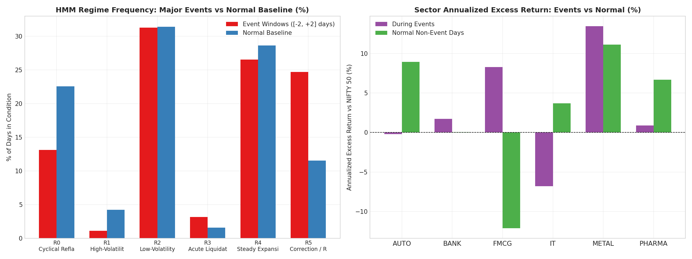
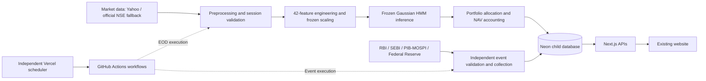

# Sector Rotation and Regime Discovery

**Market-regime research, systematic sector allocation and a deployed portfolio intelligence application for Indian equity indices.**

[Website](https://sector-rotation-regime-discovery.vercel.app) · [Research results](results/portfolio_backtest/comparative_evaluation/comparative_metrics_table.csv) · [Research implementation](src/) · [Production implementation](deployment/)

> **Research conclusion:** the four regime-driven strategies show strong full-history performance but negative returns and benchmark underperformance in the inspected 2025–2026 holdout. This repository demonstrates a research and engineering process; it does not establish a profitable out-of-sample investment strategy.

Documentation reviewed against source code and saved artifacts on **21 November 2026**. Frozen research ends **18 September 2026**. Subsequent operational data is a separate evaluation period, not an extension of the frozen research results below. Verification qualifications and known implementation differences are documented rather than silently corrected.

## Contents

1. [Overview and research objectives](#1-overview-and-research-objectives)
2. [Research hypothesis and financial foundations](#2-research-hypothesis-and-financial-foundations)
3. [Research universe and data sources](#3-research-universe-and-data-sources)
4. [Preprocessing and quality controls](#4-preprocessing-and-quality-controls)
5. [Complete 42-feature specification](#5-complete-42-feature-specification)
6. [Feature mathematics and scaling](#6-feature-mathematics-and-scaling)
7. [Chronological validation](#7-chronological-validation)
8. [K-Means, GMM and HMM comparison](#8-k-means-gmm-and-hmm-comparison)
9. [Six-state Gaussian HMM](#9-six-state-gaussian-hmm)
10. [State characterization and transitions](#10-state-characterization-and-transitions)
11. [Four portfolio configurations](#11-four-portfolio-configurations)
12. [Rebalancing and execution](#12-rebalancing-and-execution)
13. [Transaction costs and turnover](#13-transaction-costs-and-turnover)
14. [Backtesting and benchmarks](#14-backtesting-and-benchmarks)
15. [Saved performance results](#15-saved-performance-results)
16. [Robustness and statistical validation](#16-robustness-and-statistical-validation)
17. [Macroeconomic event study](#17-macroeconomic-event-study)
18. [Production architecture and data flow](#18-production-architecture-and-data-flow)
19. [Database and API architecture](#19-database-and-api-architecture)
20. [Automation, CI/CD and deployment](#20-automation-cicd-and-deployment)
21. [Technology stack](#21-technology-stack)
22. [Repository structure](#22-repository-structure)
23. [Reproducibility and setup](#23-reproducibility-and-setup)
24. [Limitations and future improvements](#24-limitations-and-future-improvements)
25. [References and acknowledgements](#25-references-and-acknowledgements)

## 1. Overview and research objectives

The project asks whether persistent statistical market regimes can guide allocation between six NSE sector indices. It combines a reproducible sequence of saved research outputs with production ingestion, frozen-model inference, portfolio accounting, an economic-event collector and an existing Next.js website.

The research workflow is:

1. Acquire and align eight daily market series.
2. Construct 42 market-direction, trend, relative-strength and volatility features.
3. Compare K-Means, Gaussian Mixture Models (GMMs) and Gaussian Hidden Markov Models (HMMs).
4. Interpret the selected six-state HMM using development-period characteristics.
5. Translate states into fixed sector pairs and four portfolio configurations.
6. Simulate holdings drift, next-session-close execution and transaction costs.
7. Compare performance with passive and momentum benchmarks, then examine robustness, uncertainty and event associations.
8. Serve stored research and operational information through a deployed application.

**Scope:** exactly six sector indices, NIFTY 50 and INDIA VIX. There is no 300-stock selection universe. K-Means, GMM and HMM are model alternatives, not an ensemble. Events provide research context and a production calendar; they are not additional HMM inputs or a live event-based allocation overlay.

## 2. Research hypothesis and financial foundations

Sector leadership can change with liquidity, growth expectations, inflation, risk appetite and market stress. Returns and relative strength describe leadership; realized volatility describes recent instability; price-to-moving-average ratios describe trend; INDIA VIX supplies market-implied uncertainty information.

The hypothesis is that these observations arise from persistent latent distributions and that conditioning allocation on those distributions can improve the return/risk trade-off. An HMM provides a probabilistic representation of persistence through state transitions.

Three distinctions matter:

- A statistically persistent state need not be an economically stable or recurring regime.
- An interpretable regime classification need not produce a profitable trading rule.
- Economic state names are post-fit interpretations, not observed labels or causal forecasts.

The implemented risk controls are long-only weights, two-sector concentration, optional cash, optional inverse-volatility sizing, confidence filtering and a holding lock. The project does not implement mean-variance optimization, a full risk-parity portfolio, leverage, short selling or a general drawdown stop.

## 3. Research universe and data sources

| Role | Instrument | Yahoo Finance identifier |
|---|---|---|
| Sector | NIFTY AUTO | `^CNXAUTO` |
| Sector | NIFTY BANK | `^NSEBANK` |
| Sector | NIFTY FMCG | `^CNXFMCG` |
| Sector | NIFTY IT | `^CNXIT` |
| Sector | NIFTY METAL | `^CNXMETAL` |
| Sector | NIFTY PHARMA | `^CNXPHARMA` |
| Market reference | NIFTY 50 | `^NSEI` |
| Volatility input | INDIA VIX | `^INDIAVIX` |

The canonical mapping is in [`src/data_loader.py`](src/data_loader.py), `VERIFIED_TICKERS`. Research acquisition uses Yahoo Finance through `yfinance`, with `auto_adjust=False`; calculations use **Close**. These are price-index simulations, not total-return-index or traded-fund results. Dividend reinvestment, tracking error and implementation frictions beyond the specified cost model are not represented.

Cash is a portfolio accounting asset, not a ninth market-data series. INDIA VIX is not traded. NIFTY 50 is the initialization holding and a benchmark; subsequent regime allocations use the six sectors and cash.

| Saved data stage | Rows | Coverage |
|---|---:|---|
| Individual raw market series | 1,887–1,905 per series | Early January 2019–18 September 2026 |
| Strictly aligned market series | 1,886 per series | 2 January 2019–18 September 2026 |
| Complete 42-feature observations | 1,687 | 31 October 2019–18 September 2026 |
| Development feature observations | 1,265 | 31 October 2019–31 December 2024 |
| Holdout feature observations | 422 | 2 January 2025–18 September 2026 |

Research inputs are in [`data/raw/`](data/raw/) and [`data/processed/`](data/processed/). The frozen macro-event inventory contains **135 events**; **122** are represented in the backtest event analysis. It is distinct from the growing operational Economic Calendar.

Production ingestion additionally supports an official dated NSE closing-report fallback, with exact-session validation. It does not change the provenance of the frozen Yahoo-based research dataset. See [`deployment/ingestion/catchup_fetcher.py`](deployment/ingestion/catchup_fetcher.py).

## 4. Preprocessing and quality controls

[`src/data_cleaning.py`](src/data_cleaning.py) implements date conversion, duplicate handling, sorting and strict common-date alignment through `clean_market_data` and `align_market_datasets`. [`src/eda.py`](src/eda.py) supports missingness, zero-volume and outlier diagnostics, distributions, correlations and event overlays.

The research pipeline does not interpolate or forward/backfill market prices. All eight series are intersected by date. Rolling-window missing values are retained during engineering and excluded from the final complete-case model matrix, leaving 1,687 observations after a 199-observation warmup.

Quality caveats:

- Eight-way intersection removes a date if any series lacks it; aligned data is not proof of complete exchange-calendar coverage.
- `clean_market_data` applies value-based `drop_duplicates()` as well as duplicate-date handling. Identical OHLCV rows on different dates can potentially be removed. The inspected raw/clean artifacts have unchanged per-series row counts.
- Zero volume in an index feed is a diagnostic, not necessarily a valid estimate of underlying constituent liquidity.
- Provider revisions, index methodology changes and historical data completeness are not fully eliminated by local validation.

Operational validation adds exact dates, required-symbol checks, finite values, OHLC consistency, source provenance and session-continuity checks. Research and production controls should not be conflated.

## 5. Complete 42-feature specification

The authoritative names and order are defined by [`src/normalization.py::get_42_features`](src/normalization.py). Let $N$ denote NIFTY 50 and $s$ a sector. Mathematical definitions follow in Section 6.

Implementation keys, all in [`src/feature_engineering.py`](src/feature_engineering.py): **F1** `calculate_returns`; **F2** `calculate_momentum_sma`; **F3** `calculate_relative_strength`; **F4** `calculate_volatility`; **F5** `calculate_market_trend`. **F6** is [`load_master_feature_dataset`](src/normalization.py), which reads observed VIX Close. The final column supplies the financial rationale, not an estimated feature importance.

| # | Exact feature name | Formula | Source | Interpretation / regime relevance |
|---:|---|---|---|---|
| 1 | `Return_20D` | $R_{N,20,t}$ | F1 | Short-horizon market direction |
| 2 | `Return_60D` | $R_{N,60,t}$ | F1 | Medium-horizon market direction |
| 3 | `NIFTY50_Momentum_20D` | $M_{N,20,t}$ | F2 | Short-term market trend positioning |
| 4 | `NIFTY50_Momentum_60D` | $M_{N,60,t}$ | F2 | Medium-term market trend positioning |
| 5 | `NIFTY50_Market_Trend_200D` | $M_{N,200,t}$ | F5 | Long-horizon market trend context |
| 6 | `VIX_Close` | Observed INDIA VIX close | F6 | Market-implied uncertainty |
| 7 | `AUTO_Return_20D` | $R_{AUTO,20,t}$ | F1 | Short-term automobile direction |
| 8 | `AUTO_Return_60D` | $R_{AUTO,60,t}$ | F1 | Medium-term automobile direction |
| 9 | `AUTO_Relative_Strength_20D` | $RS_{AUTO,20,t}$ | F3 | Recent cyclical leadership versus market |
| 10 | `AUTO_Relative_Strength_60D` | $RS_{AUTO,60,t}$ | F3 | Persistent cyclical leadership |
| 11 | `AUTO_Volatility_20D` | $V_{AUTO,20,t}$ | F4 | Recent automobile-sector instability |
| 12 | `AUTO_Volatility_60D` | $V_{AUTO,60,t}$ | F4 | Sustained automobile-sector risk |
| 13 | `BANK_Return_20D` | $R_{BANK,20,t}$ | F1 | Short-term banking direction |
| 14 | `BANK_Return_60D` | $R_{BANK,60,t}$ | F1 | Medium-term banking direction |
| 15 | `BANK_Relative_Strength_20D` | $RS_{BANK,20,t}$ | F3 | Recent financial-sector leadership |
| 16 | `BANK_Relative_Strength_60D` | $RS_{BANK,60,t}$ | F3 | Persistent financial-sector leadership |
| 17 | `BANK_Volatility_20D` | $V_{BANK,20,t}$ | F4 | Recent banking-sector instability |
| 18 | `BANK_Volatility_60D` | $V_{BANK,60,t}$ | F4 | Sustained banking-sector risk |
| 19 | `FMCG_Return_20D` | $R_{FMCG,20,t}$ | F1 | Short-term consumer-staples direction |
| 20 | `FMCG_Return_60D` | $R_{FMCG,60,t}$ | F1 | Medium-term consumer-staples direction |
| 21 | `FMCG_Relative_Strength_20D` | $RS_{FMCG,20,t}$ | F3 | Recent defensive-sector leadership |
| 22 | `FMCG_Relative_Strength_60D` | $RS_{FMCG,60,t}$ | F3 | Persistent defensive leadership |
| 23 | `FMCG_Volatility_20D` | $V_{FMCG,20,t}$ | F4 | Recent staples-sector instability |
| 24 | `FMCG_Volatility_60D` | $V_{FMCG,60,t}$ | F4 | Sustained staples-sector risk |
| 25 | `IT_Return_20D` | $R_{IT,20,t}$ | F1 | Short-term technology direction |
| 26 | `IT_Return_60D` | $R_{IT,60,t}$ | F1 | Medium-term technology direction |
| 27 | `IT_Relative_Strength_20D` | $RS_{IT,20,t}$ | F3 | Recent technology leadership |
| 28 | `IT_Relative_Strength_60D` | $RS_{IT,60,t}$ | F3 | Persistent technology leadership |
| 29 | `IT_Volatility_20D` | $V_{IT,20,t}$ | F4 | Recent technology-sector instability |
| 30 | `IT_Volatility_60D` | $V_{IT,60,t}$ | F4 | Sustained technology-sector risk |
| 31 | `METAL_Return_20D` | $R_{METAL,20,t}$ | F1 | Short-term commodity-sector direction |
| 32 | `METAL_Return_60D` | $R_{METAL,60,t}$ | F1 | Medium-term commodity-cycle direction |
| 33 | `METAL_Relative_Strength_20D` | $RS_{METAL,20,t}$ | F3 | Recent commodity-sector leadership |
| 34 | `METAL_Relative_Strength_60D` | $RS_{METAL,60,t}$ | F3 | Persistent commodity-sector leadership |
| 35 | `METAL_Volatility_20D` | $V_{METAL,20,t}$ | F4 | Recent commodity-sector instability |
| 36 | `METAL_Volatility_60D` | $V_{METAL,60,t}$ | F4 | Sustained commodity-sector risk |
| 37 | `PHARMA_Return_20D` | $R_{PHARMA,20,t}$ | F1 | Short-term pharmaceutical direction |
| 38 | `PHARMA_Return_60D` | $R_{PHARMA,60,t}$ | F1 | Medium-term pharmaceutical direction |
| 39 | `PHARMA_Relative_Strength_20D` | $RS_{PHARMA,20,t}$ | F3 | Recent healthcare/defensive leadership |
| 40 | `PHARMA_Relative_Strength_60D` | $RS_{PHARMA,60,t}$ | F3 | Persistent healthcare leadership |
| 41 | `PHARMA_Volatility_20D` | $V_{PHARMA,20,t}$ | F4 | Recent pharmaceutical-sector instability |
| 42 | `PHARMA_Volatility_60D` | $V_{PHARMA,60,t}$ | F4 | Sustained pharmaceutical-sector risk |

The unprefixed `Return_20D` and `Return_60D` are NIFTY 50 features. NIFTY 50 realized volatility exists in intermediate engineering but is excluded from this final input set. Volume, event severity and news sentiment are not HMM features.

## 6. Feature mathematics and scaling

For closing index level $P_{s,t}$ at observation $t$ and lookback $h$:

$$
R_{s,h,t}=\frac{P_{s,t}}{P_{s,t-h}}-1,
\qquad RS_{s,h,t}=R_{s,h,t}-R_{N,h,t}.
$$

These are simple trailing returns and return differences, not log returns or price ratios between sectors. A 20/60-day window means 20/60 aligned observations, not calendar days.

The momentum/trend measure is a price-to-SMA ratio:

$$
M_{N,h,t}=\frac{P_{N,t}}{\frac{1}{h}\sum_{u=0}^{h-1}P_{N,t-u}},
\qquad h\in\{20,60,200\}.
$$

A value above one means price is above its moving average. No subtraction of one is applied to these feature columns.

Realized volatility uses log returns $\ell_{s,t}=\log(P_{s,t}/P_{s,t-1})$:

$$
V_{s,h,t}=\sqrt{252}\;\operatorname{Std}_{h,\,ddof=1}(\ell_{s,t}),
\qquad h\in\{20,60\}.
$$

The sample standard deviation uses $h-1$ in its denominator. INDIA VIX is used as its observed quoted level, not converted to realized volatility.

Primary robust scaling, for feature $j$, is:

$$
z_{t,j}=\frac{x_{t,j}-m_j}{q_{0.75,j}-q_{0.25,j}},
$$

where $m_j$ and the quartiles are fitted on the relevant training sample only. Standard scaling, $(x-\mu_{train})/s_{train}$, is a sensitivity experiment. See [`fit_transform_scaler`](src/normalization.py) and the fold-specific scaling functions in [`src/regime_discovery.py`](src/regime_discovery.py).

**Redundancy:** every relative-strength feature is exactly a sector return minus the corresponding benchmark return. The 12 such identities reduce the inspected centered 42-column matrix to **rank 30**. Scaling does not remove these dependencies. Full-covariance density estimates can be sensitive to regularization, while diagonal HMM emissions ignore conditional correlations; high posterior confidence should not be interpreted as calibrated certainty.

**Cached-scaler caveat:** Phase 5 normalized CSVs are fitted through rolling-window missingness. Phase 6 reloads raw features and refits after complete-case filtering. The cached robust CSV is consequently not numerically interchangeable with the final frozen scaler. Production uses the frozen feature order, centers and scales in [`frozen_scaler.json`](deployment/engine/models/frozen_scaler.json).

## 7. Chronological validation

| Fold | Training observations begin | Training end | Validation year |
|---|---|---|---|
| 1 | 31 October 2019 | 31 December 2021 | 2022 |
| 2 | 31 October 2019 | 31 December 2022 | 2023 |
| 3 | 31 October 2019 | 31 December 2023 | 2024 |

Each expanding-window fold fits its own scaler and model. Final fitting uses the development pool ending 31 December 2024. The subsequent 422 observations are labeled `holdout` in saved artifacts.

This is chronological model-selection validation, not a complete rolling retraining/portfolio walk-forward experiment. The statistical module explicitly labels the later period **“Previously Inspected Pseudo-OOS (Holdout)”**. Its results must not be described as an untouched test set, even where older report wording says otherwise. See [`PERIOD_LABELS`](src/statistical_validation.py).

Features use contemporaneous/past closes; the strategy uses filtered rather than retrospective states and executes after the signal session. These controls reduce specific lookahead channels. They do not remove development selection bias or make all in-sample labels out-of-sample: final development labels use parameters fitted on the full development pool.

## 8. K-Means, GMM and HMM comparison

| Model | Mathematical role | Candidate/fitting design | Saved selection and interpretation |
|---|---|---|---|
| K-Means | Minimize within-cluster squared Euclidean distances; hard assignments | $K=2,\ldots,6$; K-Means++; 20 initializations; up to 500 iterations; seed 42 | Four clusters; silhouette-led selection with fold validity and smaller-model tolerance rules; unstable holdout switching |
| GMM | Fit a mixture of Gaussian densities; soft membership without transition memory | $K=2,\ldots,6$; full/diagonal/tied covariance selected using training BIC; validation likelihood selects state count | Two components, full covariance; holdout collapses to one active state |
| Gaussian HMM | Gaussian emissions plus Markov state persistence | $K=2,\ldots,6$; diagonal covariance; ten initializations per fit; validation likelihood within the HMM family | Six states; four active in holdout; chosen for temporal state differentiation |

The algorithms do not vote or combine predictions. The final allocation pipeline uses the HMM alone.

The robust-scaled six-state HMM's mean fold validation log-likelihood is **−42.039569 per observation**. The metadata value **−36.110183** is final **training** log-likelihood, not validation likelihood. GMM's selected robust two-component specification has mean validation likelihood **+21.467480**. Therefore the summary claim that the HMM has the highest cross-family numerical validation likelihood is not supported by the saved CSVs. Likelihood values must also be interpreted alongside feature redundancy, covariance structure and state usefulness.

Evidence: [`src/regime_discovery.py`](src/regime_discovery.py); [`notebooks/06_regime_discovery.ipynb`](notebooks/06_regime_discovery.ipynb); [K-Means CV](results/phase6_model_selection/kmeans/kmeans_cv_metrics.csv), [GMM CV](results/phase6_model_selection/gmm/gmm_cv_metrics.csv), [HMM CV](results/phase6_model_selection/hmm/hmm_cv_metrics.csv); [cross-model summary](results/reports/cross_model_comparison_summary.csv), whose narrative is subject to the qualification above.

## 9. Six-state Gaussian HMM

For latent state $S_t\in\{0,\ldots,5\}$, initial probabilities $\pi_j$ and transition matrix $A$:

$$
A_{ij}=\Pr(S_t=j\mid S_{t-1}=i),
\qquad \sum_j A_{ij}=1.
$$

For the scaled 42-dimensional observation $z_t$, state $j$ has mean $\mu_j$ and diagonal emission covariance $D_j=\operatorname{diag}(\sigma_{j,1}^2,\ldots,\sigma_{j,42}^2)$:

$$
b_j(z_t)=(2\pi)^{-42/2}|D_j|^{-1/2}
\exp\left[-\frac12(z_t-\mu_j)^T D_j^{-1}(z_t-\mu_j)\right].
$$

Research fitting uses `hmmlearn` EM/Baum–Welch, seeds 0–9, up to 200 iterations and tolerance $10^{-4}$. The fitting helper retains the best training-likelihood candidate satisfying its convergence check; the ten fits are not an ensemble.

Trading inference uses the causal filter $\alpha_t(j)=\Pr(S_t=j\mid z_1,\ldots,z_t)$:

$$
\alpha_1(j)=\frac{\pi_j b_j(z_1)}{\sum_k\pi_kb_k(z_1)},
\qquad
\alpha_t(j)=\frac{b_j(z_t)\sum_i\alpha_{t-1}(i)A_{ij}}
{\sum_k b_k(z_t)\sum_i\alpha_{t-1}(i)A_{ik}}.
$$

The implementation evaluates this recursion in the log domain. Raw state is $\arg\max_j\alpha_t(j)$; confidence is $\max_j\alpha_t(j)$. Confidence acceptance and portfolio rebalance eligibility are separate decisions. Probabilities are not calibrated probabilities of profit.

Retrospective Viterbi decoding uses a full sequence and is diagnostic only. [`_hmm_forward_filter`](src/regime_discovery.py) implements the research filter; [`RegimeInferenceEngine`](deployment/engine/inference_engine.py) implements frozen production inference.



*Existing research figure comparing filtered and retrospective labels. Only the causal series is appropriate as a trading input.*

**Boundary qualification:** `evaluate_holdout` starts the holdout filter from the model's initial probabilities rather than the last development posterior. An independent replay of the existing JSON parameters reproduces saved probabilities to approximately **$1.32\times10^{-10}$** maximum absolute error when this segment reset is respected. Continuous filtering instead changes one raw state at the holdout boundary. Portfolio NAV and holdings are not reset there.

Frozen artifacts: [`frozen_hmm.json`](deployment/engine/models/frozen_hmm.json), [`frozen_scaler.json`](deployment/engine/models/frozen_scaler.json), [`frozen_metadata.json`](deployment/engine/models/frozen_metadata.json). Recorded model parity does not prove complete portfolio, benchmark or operational parity.

## 10. State characterization and transitions

| State | Artifact interpretation | Development observations | Holdout observations |
|---|---|---:|---:|
| R0 | Cyclical Reflation Rally | 244 | 8 |
| R1 | High-Volatility Post-Crash Bounce | 40 | 0 |
| R2 | Low-Volatility Consolidation / Base | 397 | 118 |
| R3 | Acute Liquidation / Flight to Safety | 27 | 0 |
| R4 | Steady Expansion / Low-Volatility Bull | 353 | 170 |
| R5 | Correction / Risk-Off Digestion | 204 | 126 |

These are causal-label occupancies from [model regime profiles](results/regime_characterization/regime_profiles/model_regime_profiles.csv). State numbers are model identifiers, not an ordinal risk scale. R1 and R3 are concentrated in the COVID episode and absent from the holdout; their generality across crises is not established.

The frozen transition matrix is shown below, rounded to six decimals. Very small entries are displayed as zero; rows represent previous state and columns next state.

| From / To | R0 | R1 | R2 | R3 | R4 | R5 |
|---|---:|---:|---:|---:|---:|---:|
| R0 | .983722 | 0 | .008104 | 0 | .004102 | .004073 |
| R1 | .025000 | .975000 | 0 | 0 | 0 | 0 |
| R2 | 0 | 0 | .969489 | 0 | .025442 | .005069 |
| R3 | 0 | .037037 | 0 | .962963 | 0 | 0 |
| R4 | .002789 | 0 | .025234 | 0 | .963611 | .008367 |
| R5 | .010104 | 0 | .010099 | .005049 | .005049 | .969700 |

Mean diagonal persistence is approximately **0.97075**. This is a fitted model property, not an estimate of trading accuracy.



*Existing fitted transition matrix and stationary-distribution figure. Stationary probabilities are model-implied long-run masses, not observed holdout frequencies.*

Interpretation and sector-leadership analysis are implemented in [`src/regime_characterisation.py`](src/regime_characterisation.py).

## 11. Four portfolio configurations

| Configuration | Template | Equity sizing | Cash |
|---|---|---|---|
| **1A** | A | Equal weight in two mapped sectors | None |
| **1B** | A | Inverse volatility in two mapped sectors | None |
| **2A** | B | Prescribed pair weights | Regime-specific |
| **2B** | B | Inverse volatility within the equity budget | Regime-specific |

The rules use fixed regime-to-sector mappings rather than selecting the current daily top two:

| State | Pair | 1A sector weights | 2A sector weights | Template B cash |
|---|---|---|---|---:|
| R0 | IT / METAL | 50% / 50% | 50% / 50% | 0% |
| R1 | AUTO / METAL | 50% / 50% | 35% / 35% | 30% |
| R2 | IT / PHARMA | 50% / 50% | 50% / 50% | 0% |
| R3 | PHARMA / FMCG | 50% / 50% | **40% / 20%** | 40% |
| R4 | METAL / AUTO | 50% / 50% | 50% / 50% | 0% |
| R5 | PHARMA / FMCG | 50% / 50% | 40% / 40% | 20% |

For inverse-volatility variants, let $\mathcal S$ be the mapped pair, $c$ the cash target and $\widehat\sigma_i$ the 20-observation annualized sample volatility of log returns:

$$
u_i=\frac{1}{\max(\widehat\sigma_i,10^{-4})},
\qquad w_i=(1-c)\frac{u_i}{\sum_{j\in\mathcal S}u_j},
\qquad w_{cash}=c.
$$

Thus 2B in R3 inverse-volatility splits a 60% equity budget; it does not enforce 2A's 40%/20% split. All weights are nonnegative and sum to one. Inverse-volatility sizing has no universal 50% cap. Cash earns zero in the baseline.

Evidence: [`src/regime_rotation_rules.py`](src/regime_rotation_rules.py), especially `REGIME_SECTORS`, template cash dictionaries, `calculate_equal_weights` and `calculate_inverse_vol_weights`; schedules in [`results/portfolio_construction/`](results/portfolio_construction/).

## 12. Rebalancing and execution

The baseline threshold is **0.50** with numerical tolerance; ties use deterministic incumbent/lowest-state handling. Below-threshold signals retain the research portfolio incumbent. Invalid probability vectors are rejected rather than fabricated.

The baseline **five-session rule is a minimum holding lock, not five consecutive confirmations**. After initialization, a confident accepted state change can trigger rebalancing once the holding clock permits it. An R3 transition can bypass the lock. An unchanged regime does not cause daily inverse-volatility rebalancing. Holding state continues across year and holdout boundaries.

The execution sequence is:

1. At close $t$, observe features and compute filtered probabilities.
2. Accept/retain a regime and determine whether a rebalance is authorized.
3. During $t$ to $t+1$, existing holdings earn the market return.
4. At close $t+1$, calculate drifted holdings, execute the prior signal if authorized and deduct costs.

Let $w_{i,t}^{hold}$ be weights entering the return interval and $r_{i,t}$ the corresponding asset simple return, including zero cash return:

$$
r_t^{gross}=\sum_i w_{i,t}^{hold}r_{i,t},
\qquad
w_{i,t}^{drift}=\frac{w_{i,t}^{hold}(1+r_{i,t})}{1+r_t^{gross}}.
$$

The new target does not earn the return preceding its execution. Initial NAV is one with 100% NIFTY 50 at 31 October 2019; the first return is earned before the initial sector trade. A signal on the terminal research date has no subsequent execution within the backtest.

References: `accept_regime_signal` and `generate_schedule` in [`src/regime_rotation_rules.py`](src/regime_rotation_rules.py); [`src/portfolio_construction.py`](src/portfolio_construction.py); `simulate_portfolio` in [`src/portfolio_backtest.py`](src/portfolio_backtest.py).

## 13. Transaction costs and turnover

Actual one-way turnover at an executed rebalance is:

$$
TO_t=\frac12\sum_i\left|w_{i,t}^{target}-w_{i,t}^{drift}\right|.
$$

It is zero on a no-trade session even when holdings drift. Nominal turnover compares consecutive target allocations and is a separate quantity.

For cost rate $\kappa=0.0015$ (15 basis points per unit of one-way turnover):

$$
NAV_t^{pre}=NAV_{t-1}^{net}(1+r_t^{gross}),
\qquad C_t=\kappa\,TO_t\,NAV_t^{pre},
$$

$$
NAV_t^{net}=NAV_t^{pre}(1-\kappa TO_t),
\qquad r_t^{net}=\frac{NAV_t^{net}}{NAV_{t-1}^{net}}-1.
$$

$C_t$ is the NAV-unit cost amount, not a constant daily return deduction. Gross NAV is separately compounded without costs. Additive return attribution uses asset contributions plus $r_t^{net}-r_t^{gross}$ as cost drag.

For $N$ return intervals:

$$
TO^{cum}=\sum_t TO_t,
\qquad TO^{ann}=\frac{252}{N}\sum_t TO_t.
$$

A value of 1.0 is 100% one-way turnover; complete replacement has 200% gross buys-plus-sells under that alternative convention. The initial NIFTY-to-sector allocation is such a 100% turnover event. A cumulative value of 50.56 means approximately 5,056%, not 50.56%.

| Configuration | Full cumulative turnover | Full annualized turnover | Rebalances: full / holdout |
|---|---:|---:|---:|
| 1A | 50.561 | 7.557 | 58 / 20 |
| 1B | 51.606 | 7.713 | 58 / 20 |
| 2A | 51.233 | 7.658 | 58 / 20 |
| 2B | 52.103 | 7.788 | 58 / 20 |

Stored holdings and daily actual turnover independently reconcile to floating-point precision. The many 0%/100% observations follow event-triggered trading and often disjoint old/new sector pairs; they are not evidence of daily rebalancing.

## 14. Backtesting and benchmarks

There are **1,687 signal dates** but **1,686 return intervals**. Simulation returns run from 1 November 2019 to 18 September 2026: 1,264 development intervals and 422 holdout intervals. NAV, incumbent holdings and holding clocks continue across the split. Holdout performance is measured relative to the preceding development-end NAV, not against the original unit NAV.

Research benchmarks are:

- **NIFTY 50 buy-and-hold:** price-index return, no recurring trading or initial funding cost.
- **Equal-weight six-sector:** monthly month-end signals, next-session-close execution, one-sixth targets, drift between trades and 15-bps actual-turnover costs.
- **Momentum sensitivity benchmark:** 20-session return ranking, monthly top-two selection, equal weights and next-close execution.

For net daily returns $r_t$, sample size $N$, sample standard deviation $s_r$ and mean $\bar r$:

$$
TR=\prod_{t=1}^{N}(1+r_t)-1,
\qquad CAGR=(1+TR)^{252/N}-1,
$$

$$
Vol=\sqrt{252}\,s_r,
\qquad Sharpe=\frac{252\bar r}{\sqrt{252}\,s_r},
$$

$$
Sortino=\frac{\sqrt{252}\,\bar r}
{\sqrt{\frac1N\sum_{t=1}^{N}\min(r_t,0)^2}},
\qquad MDD=\min_t\left(\frac{NAV_t}{\max_{u\leq t}NAV_u}-1\right).
$$

Annualization uses 252. Sharpe risk-free rate and Sortino minimum acceptable return are zero. Downside deviation averages squared negative parts across **all** sessions, not only negative sessions. Drawdown is stored as a negative number. For period-specific drawdown, the saved comparison implementation uses the cumulative return path without prepending a separate unit-NAV observation, which matters at an initially declining boundary.

Zero-denominator Sharpe/Sortino branches return zero in the code; this convention is not a claim of statistical certainty. Calmar is not provided because it was not found among the implemented/saved research comparison metrics.

Evidence: [`src/benchmark_backtest.py`](src/benchmark_backtest.py), [`src/portfolio_backtest.py`](src/portfolio_backtest.py), [`src/comparative_evaluation.py`](src/comparative_evaluation.py).

## 15. Saved performance results

The following values are rounded from the [saved comparative table](results/portfolio_backtest/comparative_evaluation/comparative_metrics_table.csv), not estimated from chart pixels or generated from live website data. Full period is **1 November 2019–18 September 2026**; holdout is **2 January 2025–18 September 2026**.

### Full history versus inspected holdout

Each paired entry is **full / holdout**. Returns, CAGR, volatility and maximum drawdown are percentages; Sharpe and Sortino are dimensionless.

| Portfolio | Net total return | Net CAGR | Annualized volatility | Sharpe | Sortino | Max drawdown |
|---|---:|---:|---:|---:|---:|---:|
| 1A | 392.09 / **−19.08** | 26.89 / **−11.87** | 19.35 / 15.43 | 1.328 / −0.742 | 1.909 / −0.946 | −25.60 / −25.11 |
| 1B | 384.82 / **−19.52** | 26.61 / **−12.16** | 19.01 / 15.12 | 1.337 / −0.781 | 1.932 / −0.992 | −26.10 / −25.62 |
| 2A | 324.05 / **−20.72** | 24.10 / **−12.95** | 17.45 / 14.71 | 1.325 / −0.869 | 1.891 / −1.096 | −25.74 / −25.74 |
| 2B | 313.66 / **−21.10** | 23.64 / **−13.20** | 17.07 / 14.41 | 1.329 / −0.910 | 1.907 / −1.140 | −25.69 / −25.69 |
| NIFTY 50 | 96.56 / −1.26 | 10.63 / −0.76 | 17.73 / 13.23 | 0.659 / 0.009 | 0.896 / 0.012 | −38.44 / −15.18 |
| Equal-weight six-sector | 180.47 / +5.54 | 16.67 / +3.27 | 17.06 / 13.58 | 0.990 / 0.305 | 1.354 / 0.426 | −36.87 / −13.34 |

Development-period net CAGRs are approximately 43.32%, 43.05%, 39.70% and 39.14% for 1A, 1B, 2A and 2B respectively. The disparity with holdout results shows why full-history outperformance cannot establish generalization. All four configurations lose approximately 19–21% in the holdout and have worse drawdowns than both principal passive benchmarks.



*Existing 1A diagnostic. The left panel mixes geometric performance measures with explicitly scaled ratios; the right panel is arithmetic annualized contribution, not a geometric CAGR decomposition.*

Independent read-only recalculation of seven metrics across six portfolios and three periods reproduced **126 values** with maximum absolute discrepancy approximately **$3.13\times10^{-12}$**. Numerical reconciliation establishes consistency of saved returns and metrics; it does not establish an unbiased experiment or investable alpha.

Daily evidence is available in [`results/portfolio_backtest/`](results/portfolio_backtest/). Standalone exported equity-curve images and website screenshots were not found among the inspected image assets; none have been fabricated or generated for this README.

## 16. Robustness and statistical validation

[`src/robustness/`](src/robustness/) and [`results/portfolio_backtest/robustness/`](results/portfolio_backtest/robustness/) contain:

| Analysis | Actual scope | Interpretation |
|---|---|---|
| Costs | 0, 5, 10, 15, 20, 25, 30 bps | Negative holdout performance remains even without costs |
| Execution | Same close, next close, second-next close, next open | Same-close case is an optimistic diagnostic; timing sensitivity is material |
| Parameters | Confidence thresholds, holding locks and inverse-volatility lookbacks | Sensitivity checks are not independent unseen-data validation |
| Subperiods | Years, moving-average trend conditions and fixed VIX bins | Aggregate metrics conceal environmental dependence |
| Regimes | State-conditioned metrics and transition diagnostics | Crisis-state generality remains weakly tested |
| Concentration | HHI, effective holdings and contribution analysis | Two-sector concentration is explicit |
| Benchmarks | Passive and monthly top-two momentum alternatives | Simple alternatives can outperform the ML allocation in holdout |

For example, 1A holdout CAGR is −10.44% at zero cost, −11.87% at 15 bps and −13.29% at 30 bps. Costs are not the sole explanation for failure. The momentum sensitivity benchmark's holdout CAGR is approximately −7.10%, better than all four ML variants but worse than the two principal passive benchmarks.

[`src/statistical_validation.py`](src/statistical_validation.py) implements HAC alpha/beta estimation, Sharpe inference, paired Sharpe comparisons, stationary bootstrap and Holm/BH/BY adjustments. The default statistical bootstrap uses 2,000 replications and a 21-session expected block length, with block-length sensitivity. This is separate from the 1,000-replication event bootstrap.

### Interpretation limitations and known errors

- The holdout is explicitly previously inspected; it is pseudo-out-of-sample, not a sealed test set.
- Sharpe inference functions choose their reported one-sided normal tail from the observed statistic's sign. These are not fixed-direction superiority tests.
- The bootstrap's studentized path sets each replicate standard error to the original estimate (`boot_ses[b] = se_hat`). It is an approximation, not full replicate-specific studentization.
- The inspected multiple-testing artifact reports no Holm rejection among the 12 holdout comparisons; it does not support a claim of statistically established holdout superiority.
- Event adjusted-p-value fields contain a separate confirmed reporting error described next.

Saved statistical outputs are in [`results/statistical_validation/`](results/statistical_validation/). No p-value or significance claim should be interpreted without checking direction, period, benchmark, multiplicity and the qualifications above.

## 17. Macroeconomic event study

The frozen inventory spans policy, tariffs, geopolitics, domestic fiscal policy, financial shocks, health/pandemic events and elections. It contains 135 events; 122 eligible events are analyzed across 68 represented macro episodes. Same-date events need not be duplicates.

[`src/event_analysis.py`](src/event_analysis.py) aligns events to trading observations and estimates a pre-event sector market model:

$$
r_{s,t}=a_s+b_s r_{N,t}+\varepsilon_{s,t},
\qquad AR_{s,t}=r_{s,t}-(\widehat a_s+\widehat b_s r_{N,t}),
$$

$$
CAR_{s,[u,v]}=\sum_{\tau=u}^{v}AR_{s,t_e+\tau}.
$$

Here $t_e$ is the aligned event session, $a_s,b_s$ are estimated from pre-event observations, and $AR/CAR$ denote abnormal/cumulative abnormal returns. Estimation uses tiered lookbacks and clean-observation eligibility checks. Panels include $[-5,+5]$; CAR windows include $[-2,+2]$ and $[-5,+5]$. Episode clustering addresses overlapping related events; the category/sector CAAR bootstrap uses 1,000 replications and seed 42.

Other outputs examine filtered-state association, sector leadership, dispersion and portfolio event-window behavior. These are descriptive associations, not causal identification or an implemented event-trading strategy.



*Existing descriptive comparison of state frequencies and sector excess returns. Event-window annualization and category overlap require caution; the figure is not proof of causal impact or adjusted significance.*

**Confirmed adjusted-p-value error:** correction helpers return `(adjusted_p_values, rejection_flags)`, but `run_episode_clustered_caar_bootstrap` stores their second output as `p_value_holm` and `p_value_bh`. The saved fields are Boolean flags, not p-values. Comparing `False` numerically with 0.05 creates an invalid significance count. Independently correcting the 42 raw bootstrap p-values gives a minimum Holm-adjusted p-value of **0.252** and **zero 5% rejections**. Existing artifacts remain unchanged; do not quote their mislabeled fields as adjusted p-values.

Evidence: [CAAR artifact](results/event_analysis/macro_category_caar.parquet), [event metadata](results/event_analysis/event_metadata_authoritative.parquet), [episodes](results/event_analysis/macro_episodes_summary.parquet), and correction return contracts in [`src/statistical_validation.py`](src/statistical_validation.py).

Historical event provenance is incomplete at the release-URL level. The code also clamps an event beyond the available price end to the last trading observation; current analyzed inventory does not establish a triggering example, but future reuse needs explicit range validation.

## 18. Production architecture and data flow

Research runs in Python/notebooks and stores CSV/Parquet results. Production uses frozen JSON model parameters, existing database history and incremental daily processing. There is no online model retraining in the EOD path.



| Component | Implementation responsibility |
|---|---|
| Research | [`src/`](src/) and [`notebooks/`](notebooks/): fitting, experiments and saved analysis |
| Ingestion | [`deployment/ingestion/`](deployment/ingestion/): providers, session validation, bounded catch-up and provenance |
| Features/inference | [`deployment/engine/`](deployment/engine/): existing candle history, frozen scaler and recursive HMM |
| Publication | [`deployment/scripts/run_daily_eod.py`](deployment/scripts/run_daily_eod.py): portfolio/benchmark calculation and coordinated persistence |
| Events | [`deployment/events/`](deployment/events/): official discovery, coverage, deduplication, checkpoints and logging |
| API/frontend | [`deployment/web/`](deployment/web/): Next.js server handlers and React visualization |
| Independent dispatch | [`deployment/automation/`](deployment/automation/): workflow triggers, retries and operational alerts |

The Event Intelligence page uses frozen research artifacts; the Economic Calendar consumes operational events. Research performance and post-research operational NAV must retain their date/period labels.

### Research–production parity limits

These differences are confirmed in source and are not corrected by this documentation:

| Area | Difference / qualification |
|---|---|
| Model probabilities | Frozen replay matches the segmented historical research filter; this is narrower than whole-system parity |
| Equal-weight benchmark | Research rebalances monthly with drift/costs. Production uses the daily arithmetic mean of six sector returns with zero recorded turnover/cost |
| Simulation metadata | Production sets simulation `rebalance_bypassed_r3` to false and `nominal_turnover` to actual turnover; allocation records separately retain a bypass flag |
| Low-confidence incumbent | Research uses the portfolio incumbent; production filtering carries a global previously accepted state before portfolio holding-lock decisions. Some blocked-transition/low-confidence sequences can differ |

The incumbent difference is a code-level risk, not evidence of a specific incorrect live trade. See [`deployment/scripts/run_daily_eod.py`](deployment/scripts/run_daily_eod.py) and [`deployment/engine/inference_engine.py`](deployment/engine/inference_engine.py).

## 19. Database and API architecture

The principal schema is defined in [`001_initial_schema.sql`](deployment/database/migrations/001_initial_schema.sql):

| Table | Key / purpose |
|---|---|
| `index_candles_daily` | Symbol/date candles, ingestion provenance and reconciliation fields |
| `market_features_daily` | Date-keyed raw/scaled JSON feature vectors |
| `regime_inference_daily` | Date-keyed probabilities, raw/accepted regime and confidence |
| `portfolio_allocations_daily` | Variant/date signals, execution dates, holding state and target weights |
| `portfolio_simulations_daily` | Variant/date NAV, returns, actual/nominal turnover, costs and holdings |
| `benchmark_simulations_daily` | Benchmark/date NAV, returns and turnover |
| `macro_events` | Event identity, date, category, title, values and source metadata |
| `pipeline_execution_logs` | Execution identity, status, trigger and structured diagnostics |
| `reconciliation_audit_logs` | Reconciliation decisions and provenance |

Cumulative turnover is derived from daily actual values for the selected period or all available history; it is not an independently required cumulative database field. NAV and regime histories are stored rather than reconstructed by frontend interpolation.

The EOD writer validates the approved child target, uses serializable derived publication, an advisory lock, exact expected record counts and session continuity. Derived publication is insert-only. Raw candles are ingested separately, so a failed derived transaction can leave raw-only progress that recovery must address. General reconciliation utilities support revision updates for other callers; the guarded EOD path disables them.

The website's [`lib/neon.ts`](deployment/web/lib/neon.ts) is server-side, uses TLS HTTPS queries, rejects write SQL, parameterizes values and avoids exposing upstream credentials/errors. This application guard is not a substitute for a database-enforced least-privilege role. Its host validation accepts Neon generally rather than independently proving child identity.

### Public API routes

| Endpoint | Exposes |
|---|---|
| `/api/v1/health` | Data-service health, session freshness and publication checks |
| `/api/v1/portfolios` | Portfolio records, metrics and period filters |
| `/api/v1/portfolios/history` | Historical NAV, turnover, allocation and execution information |
| `/api/v1/regime/latest` | Latest probabilities, raw/accepted regime and confidence |
| `/api/v1/regime/history` | Historical daily regime information |
| `/api/v1/rrg` | Sector rotation data |
| `/api/v1/events` | Operational economic-calendar events |

Handlers are in [`deployment/web/app/api/v1/`](deployment/web/app/api/v1/). There are seven API routes and eight website pages, not eight of each.

### Website routes and verification scope

| Page | Production URL |
|---|---|
| Overview | [Home](https://sector-rotation-regime-discovery.vercel.app/) |
| Portfolio Analytics | [/portfolio-analytics](https://sector-rotation-regime-discovery.vercel.app/portfolio-analytics) |
| Regime Intelligence | [/regime-intelligence](https://sector-rotation-regime-discovery.vercel.app/regime-intelligence) |
| Sector Rotation | [/sector-rotation](https://sector-rotation-regime-discovery.vercel.app/sector-rotation) |
| Risk & Drawdown | [/risk-drawdown](https://sector-rotation-regime-discovery.vercel.app/risk-drawdown) |
| Event Intelligence | [/event-intelligence](https://sector-rotation-regime-discovery.vercel.app/event-intelligence) |
| Economic Calendar | [/economic-calendar](https://sector-rotation-regime-discovery.vercel.app/economic-calendar) |
| Research Methodology | [/research-methodology](https://sector-rotation-regime-discovery.vercel.app/research-methodology) |

The preceding read-only audit observed HTTP 200 for all eight pages, healthy publication through 20 November 2026 and 237 calendar events. Network access during this documentation pass did not permit a fresh public HTTP verification; those observations are dated evidence, not an availability guarantee. No new desktop/mobile interaction review, authenticated deployment inspection or direct live database integrity check was performed for this README.

## 20. Automation, CI/CD and deployment

The website's Vercel root is **`deployment/web`**. The independent scheduler is a separate project, **`sector-rotation-automation`**, rooted at **`deployment/automation`**. Website deployment, pipeline execution and scheduler deployment are distinct concerns.

| Workflow | Nominal weekdays, IST | GitHub cron, UTC |
|---|---|---|
| EOD primary | 19:00 | `30 13 * * 1-5` |
| EOD retries | 19:30, 20:00, 20:30 | `00 14`, `30 14`, `00 15` on weekdays |
| Event collection | 21:00 | `30 15 * * 1-5` |
| Event health | 23:00 | `30 17 * * 1-5` |

Sources: [`daily_eod.yml`](.github/workflows/daily_eod.yml), [`daily_events.yml`](.github/workflows/daily_events.yml). Both support manual dispatch but are designed for unattended operation. Independent concurrency groups prevent overlapping executions within each service without cancelling active work.

The cloud dispatcher retains native GitHub cron as a backup clock. It uses deterministic service/date/slot keys, checks queued/running/completed runs before dispatch, bounds retry attempts, observes ambiguous dispatch outcomes and creates marked GitHub failure issues. Business idempotency remains essential: trigger delivery is not an exactly-once transaction.

Event automation has Python 3.11/3.13 offline test jobs before its operational job. EOD uses Python 3.11. The independent scheduler has mocked-request Node tests. These are specific checks, not proof of a complete CI gate over every research and website behavior. Website scripts expose test/typecheck/build commands separately.

Required configuration **names only**:

| Context | Names / role |
|---|---|
| Website and EOD | `DATABASE_URL`; existing compatibility fallback `NEON_DATABASE_URL` |
| Events | `DATABASE_URL`, `EVENT_AUTOMATION_ENABLED` |
| Isolated persistence tests | `EVENT_TEST_DATABASE_URL`, `EVENT_TEST_BRANCH_CONFIRMED` |
| Independent dispatcher | `AUTOMATION_GITHUB_TOKEN`, `AUTOMATION_ENABLED` |

The dispatcher token is repository-scoped for Actions read/write, Issues read/write and Metadata read. The dispatcher does not need a database URL. Persistence tests must target the approved child branch's disposable **`eod_ops_test`** database; the website-serving **`neondb`** is forbidden for synthetic tests. Target identity protections reside in application code and must not be bypassed by changing an environment name alone.

Event source integrations use official RBI, SEBI, PIB/MOSPI and Federal Reserve discovery. Archive/date coverage evidence, rejected-item diagnostics, transactional deduplication and checkpoint guards are separate from scheduler success. A successful trigger does not establish complete source coverage or database publication.

Operational limitations include scheduler timing jitter, token expiry, shared failure dependencies between dispatch and GitHub issue alerts, and calendar maintenance. The reviewed backend calendar covers 2026 and fails closed outside supported coverage. Website freshness uses a simpler weekday/cutoff rule and can disagree on exchange holidays. No uptime SLA, guaranteed future execution or newly verified secret scope is claimed here. See [scheduler operations documentation](deployment/automation/README.md).

## 21. Technology stack

| Technology | Responsibility |
|---|---|
| Python, pandas, NumPy | Research data, features, simulation and operational processing |
| scikit-learn | Scaling, K-Means and GMM |
| hmmlearn | Research HMM fitting |
| SciPy, statsmodels | Numerical distributions and statistical inference |
| PyArrow / Parquet, CSV | Saved research artifacts |
| Jupyter, Matplotlib, seaborn | Research notebooks and figures |
| yfinance, official NSE reports | Market acquisition |
| PostgreSQL / Neon | Operational persistence |
| Next.js, React, TypeScript | Website and server API routes |
| Recharts, Tailwind CSS | Charts and styling |
| GitHub Actions | Pipeline execution and workflow-level checks |
| Vercel, `@vercel/schedules` | Hosting and independent workflow dispatch |

Production inference uses frozen parameters and numerical code, not a hosted `hmmlearn` training service. The API is implemented by Next.js route handlers, not a separate FastAPI or Flask server. Exact web dependency resolutions are in [`package-lock.json`](deployment/web/package-lock.json); Python research dependencies are not comprehensively pinned.

## 22. Repository structure

```text
.
├── README.md
├── requirements.txt                 # Early-stage acquisition dependencies; incomplete research environment
├── src/                             # Research implementation
│   └── robustness/                  # Costs, timing, parameters, regimes and concentration
├── tests/                           # Research regression tests
├── notebooks/                       # Executed research stages and analysis
├── data/
│   ├── raw/                         # Eight series and historical event inventory
│   └── processed/                   # Cleaned, aligned, engineered and normalized data
├── results/                         # Model comparisons, probabilities, portfolios and statistics
├── reports/                         # Existing reports, figures and presentations
├── deployment/
│   ├── engine/                      # Frozen model, features and portfolio computation
│   ├── ingestion/                   # Market providers, validation and recovery
│   ├── database/                    # Access layer and migration definitions
│   ├── events/                      # Independent event collector
│   ├── scripts/                     # Operational entry points and other utilities
│   ├── tests/                       # Offline and opt-in persistence tests
│   ├── web/                         # Existing Next.js website
│   └── automation/                  # Independent Vercel scheduler
└── .github/workflows/               # Independent EOD and event workflows
```

Source is authoritative when report prose or historical notebook commentary conflicts with implementation. Existing reports and datasets are retained as research evidence rather than rewritten to match this README.

## 23. Reproducibility and setup

### Start with saved evidence

Read the [metric CSV](results/portfolio_backtest/comparative_evaluation/comparative_metrics_table.csv), [probability CSV](results/regime_discovery/hmm_causal_probabilities.csv), [model profiles](results/regime_characterization/regime_profiles/model_regime_profiles.csv), notebooks and frozen JSON before running generators. They can be inspected without installing packages or contacting a database.

The documentation rechecks used existing local libraries and in-memory arithmetic only: no pipeline execution, model training, artifact regeneration, database test, build or deployment. Results were checked for feature rank, saved metric consistency, frozen segmented filtering and holdings-based turnover. These checks do not constitute a freshly executed complete test suite.

### Research environment

Use an isolated Python environment; Python 3.11 aligns with operational workflow configuration. [`requirements.txt`](requirements.txt) covers early data acquisition but is **not a complete research lockfile**. Research additionally uses scikit-learn, hmmlearn, SciPy, statsmodels, PyArrow, Matplotlib, seaborn and pytest. Compatible versions must be recorded before claiming exact fitting reproducibility; installing current releases is not an exact reconstruction of the original environment.

For a user-authorized new environment, the existing acquisition requirements can be installed with:

```bash
python -m pip install -r requirements.txt
```

This command installs dependencies; it is not required for reading the saved results. Additional research dependencies must be resolved separately. Notebooks and generator functions can write datasets/results. Do not execute all notebooks indiscriminately against the preserved working repository.

In particular, [`serialize_frozen_models.py`](deployment/scripts/serialize_frozen_models.py) refits and writes model JSON before its parity assertion. It is not a harmless export-only command and is not part of a read-only setup.

### Existing website

From `deployment/web`, the package scripts support the following **optional, user-run commands**:

```bash
npm ci
npm test
npm run typecheck
npm run build
npm run start -- --hostname 127.0.0.1 --port 3210
```

Installation/build commands create dependencies/build outputs; `next start` requires a successful existing production build. Run `next dev` only when intentionally developing, not concurrently against the same build directory. These commands were not run while creating this documentation.

Supply `DATABASE_URL` through a secure process environment or authorized hosting secret, pointing only to the approved child database. Never paste credentials into shell examples, screenshots or Git. The server helper also reads existing environment-file fallbacks; verify the effective target rather than assuming an unset variable is safe. Do not use Neon `main` for local verification.

### Tests and database safety

Event offline tests explicitly listed by the workflow can be run, after dependencies are prepared, without enabling collection:

```bash
python -B -m pytest -q -p no:cacheprovider deployment/tests/test_event_ingestion.py deployment/tests/test_event_automation.py deployment/tests/test_event_feed_recovery.py deployment/tests/test_event_archives.py
```

The event offline suite requires pytest and PyYAML as specified in the workflow. Do not replace this whitelist with an unreviewed broad `deployment/tests` invocation: persistence and legacy tests may write or delete fixtures. Opt-in persistence testing requires the independently verified disposable `eod_ops_test` target, explicit confirmation and separate authorization. No synthetic fixtures belong in the website database.

Website tests, TypeScript checks, builds and pipeline tests have different scopes. None alone proves fresh market publication, source completeness, desktop/mobile interaction correctness or future scheduled execution. Full research retraining also requires resolving environment and experiment-provenance gaps.

## 24. Limitations and future improvements

The following are documented findings or proposed work, **not changes implemented by this README**:

| Finding | Consequence / next research or engineering question |
|---|---|
| Negative inspected holdout | Evaluate a genuinely new future period before claiming generalization |
| Previously inspected test period | Use honest pseudo-OOS labeling; separate future untouched evaluation |
| Redundant 42-feature specification | Study ablation/covariance alternatives in a separately versioned experiment, not by altering frozen results |
| Limited crisis observations | Test whether stress states recur outside the COVID episode |
| Misreported train/validation likelihood | Reconcile report wording with saved CV and metadata |
| Event correction-output error | Correct code and regenerate outputs only under separately authorized research change control |
| Direction-adaptive one-sided p-values | Specify hypotheses/directions before testing |
| Approximate bootstrap studentization | Compare with replicate-specific or otherwise justified inference |
| Index price simulation | Examine TRI data and realistic funds, liquidity, taxes and tracking costs |
| Two-sector concentration, zero cash yield | Quantify concentration and opportunity-cost sensitivity |
| Holdout filter reset | Explicitly distinguish segmented historical evaluation from continuous inference |
| Research/production benchmark and metadata differences | Establish a full replay/parity contract before claiming equivalence |
| Incomplete dependency/seed provenance | Record a reproducible environment and selected fit metadata |
| Event inventory provenance gaps | Add independently verified historical release references in a new authorized dataset version |
| Calendar and monitoring limits | Maintain supported years and independent outage detection |

No feature-importance estimates, calibrated probability claims, Calmar ratios, causal event effects or institutional-grade validation claims are supplied where evidence is absent. Current report/reference prose may contain older or contradictory claims; linked code and artifacts plus the explicit qualifications above take precedence.

Direct database-role/constraint inspection, a baseline comparison proving every original operational event unchanged, current authenticated deployment-to-commit mapping and exhaustive fresh desktop/mobile interaction checks remain outside this documentation verification. Existing market/event records and frozen research artifacts were not modified.

## 25. References and acknowledgements

### Primary project evidence

- [Acquisition](src/data_loader.py), [cleaning/alignment](src/data_cleaning.py), [features](src/feature_engineering.py), [scaling](src/normalization.py).
- [Model selection and causal filtering](src/regime_discovery.py), [regime characterization](src/regime_characterisation.py), [rotation rules](src/regime_rotation_rules.py).
- [Portfolio simulation](src/portfolio_backtest.py), [benchmarks](src/benchmark_backtest.py), [comparative metrics](src/comparative_evaluation.py), [statistical validation](src/statistical_validation.py), [event study](src/event_analysis.py).
- [Saved comparative results](results/portfolio_backtest/comparative_evaluation/comparative_metrics_table.csv), [frozen model metadata](deployment/engine/models/frozen_metadata.json), [database schema](deployment/database/migrations/001_initial_schema.sql), [scheduler operations](deployment/automation/README.md).

### External implementation and data references

- [scikit-learn RobustScaler](https://scikit-learn.org/stable/modules/generated/sklearn.preprocessing.RobustScaler.html): median/IQR scaling used by the implementation.
- [hmmlearn documentation](https://hmmlearn.readthedocs.io/en/latest/): research HMM fitting and inference library.
- [NSE Indices: Total Return Index](https://www.niftyindices.com/resources/index-concepts/total-return-index): distinction between price return and dividend-reinvested total return.
- [yfinance project](https://github.com/ranaroussi/yfinance): interface used for Yahoo market-data acquisition.

The project uses open-source scientific Python and web tooling, Yahoo market feeds and official release sources. These acknowledgements do not imply endorsement by data providers or institutions. Existing report bibliography entries marked as pending confirmation are not presented here as verified academic references.

This repository is research and engineering documentation, not an investment recommendation or a claim that historical simulated returns will recur.
