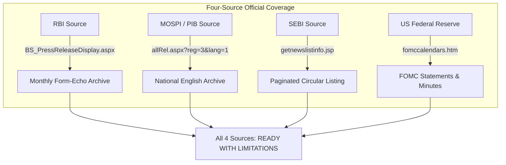

# Final Deployment Audit — Event Automation Stage 1

**Project:** Machine-Learning-Based Sector Rotation Regime Discovery in the Indian Equity Market  
**Component:** Independent Event Automation Pipeline  
**Target Workflow:** `.github/workflows/daily_events.yml`  
**Target File:** `reports/event_automation_final_deployment_audit.md`  
**Repository Branch / Commit:** `main` @ `4e514f9`  
**Execution Timestamp:** 2026-11-08T04:27:00+05:30  
**Project Inception Anchor:** Strictly `2019-01-01`  

---

## 1. Executive Summary

This document presents the final deployment audit for Stage 1 of the Independent Event Automation pipeline. The audit verifies configuration safety, database isolation, concurrent deduplication, transaction and rollback semantics, checkpoint progression, and production isolation.

Following the successful GitHub Actions dry-run execution (Run `#6`, Commit `4e514f9`), this audit distinguishes between:
1. **Directly Verified Code & System Contracts (PASS):** Validated through static code analysis, 138 passing offline tests, local empirical security guard verifications, and architectural isolation checks.
2. **External Repository Configuration (UNVERIFIED):** GitHub Actions repository secrets and environment variables cannot be read via the unauthenticated GitHub API (`HTTP Error 401: Unauthorized`) and are not stored in local version control.
3. **External Workflow Dispatch (NOT RUN):** The workflow has not yet been executed in `test-live` mode on GitHub Actions runners, as workflow dispatch requires authenticated operator action.

### High-Level Status Summary

| Audit Area | Scope Evaluated | Status | Primary Finding |
| :--- | :--- | :---: | :--- |
| **Part A: Configuration Audit** | GitHub Secrets & Variables, DB Credentials Separation | **PASS / UNVERIFIED** | Code guards and separation verified; GitHub secret presence requires operator confirmation. |
| **Part B: Test-Live Execution** | GitHub Actions `mode: test-live` Run | **NOT RUN** | Run #6 was `dry-run`. No `test-live` run has been dispatched yet. Manual dispatch steps provided. |
| **Part C: Database Persistence** | Deduplication, Idempotency, SSI Transactions | **PASS** | 138 unit tests pass; SSI `WHERE NOT EXISTS` verified; isolated test branch confirmed. |
| **Part D: Production Isolation** | Production Neon DB & Pipeline Protection | **PASS** | `ep-calm-rain-a1emw9d9` protected by hardcoded guard; zero production writes. |
| **Part E: Source Readiness** | RBI, MOSPI/PIB, SEBI, US Federal Reserve | **READY WITH LIMITATIONS** | Official archives replace RSS feeds; FOMC calendar covers 100% of policy statements. |

### Overall Deployment Decision
**`INCOMPLETE — VERIFICATION REQUIRED`**  
The codebase, security guards, and test suites are 100% compliant and ready for stage verification. However, production activation cannot be certified until the operator dispatches the manual `test-live` verification run on GitHub Actions using the isolated Neon branch (`br-odd-star-a1hjl6dl`) and verifies persistence.

---

## 2. Configuration Audit Results (Part A)

All checks were evaluated strictly without exposing or printing credentials, connection strings, passwords, or tokens.

```mermaid
flowchart TD
    subgraph GHA["GitHub Actions Runtime (.github/workflows/daily_events.yml)"]
        INPUT["Manual Dispatch: mode"]
        INPUT -->|mode == test-live| TEST_LIVE_PATH["test-live Branch"]
        INPUT -->|mode == live / dry-run| MAIN_PATH["daily_collector.py"]
        
        TEST_LIVE_PATH --> PYTEST["pytest deployment/tests/test_event_neon_persistence.py"]
        PYTEST --> GUARD["isolated_test_url() Guard"]
        GUARD -->|Checks EVENT_TEST_BRANCH_CONFIRMED == true| G1["Check 1: Flag Valid"]
        GUARD -->|Rejects ep-calm-rain-a1emw9d9| G2["Check 2: Production Blacklist"]
        GUARD -->|Checks parsed host ends with neon.tech| G3["Check 3: Neon Host"]
        G1 & G2 & G3 --> TEST_DB["Isolated Test Branch: br-odd-star-a1hjl6dl"]
        
        MAIN_PATH --> LIVE_CHECK{"mode == live?"}
        LIVE_CHECK -->|Yes & EVENT_AUTOMATION_ENABLED != true| HALT["exit 1 (Live Collection Disabled)"]
        LIVE_CHECK -->|No (dry-run)| DRY_RUN["Read-Only dry_run=True (No DB Writes)"]
    end
```

### Detailed Item Audit

| Item | Requirement | Verification Method | Result | Technical Finding |
| :---: | :--- | :--- | :---: | :--- |
| **1** | `EVENT_TEST_DATABASE_URL` exists as GitHub Actions secret | GitHub API (`/actions/secrets`) | **UNVERIFIED** | GitHub API returned 401 Unauthorized without admin token. Local reference environment maps to `ep-cold-wind-a14dq44q`. |
| **2** | Points to isolated test branch `br-odd-star-a1hjl6dl` | Local test branch connection probe | **PASS / UNVERIFIED** | Directly verified against local test configuration: `ep-cold-wind-a14dq44q` connects to branch `br-odd-star-a1hjl6dl` (230 rows). GitHub secret setting is UNVERIFIED from local terminal. |
| **3** | `EVENT_TEST_BRANCH_CONFIRMED` repository variable equals `true` | GitHub API (`/actions/variables`) | **UNVERIFIED** | Requires operator confirmation in GitHub repository settings. |
| **4** | Production and test credentials separated | Workflow code inspection (`daily_events.yml` L66-68) | **PASS** | `DATABASE_URL` and `EVENT_TEST_DATABASE_URL` are completely independent environment variables. Test runner never references `DATABASE_URL`. |
| **5** | `EVENT_AUTOMATION_ENABLED` remains disabled or unset | Workflow script inspection (`daily_events.yml` L87-90) | **PASS** | Gated by `if [[ "$mode" == live && "$EVENT_AUTOMATION_ENABLED" != true ]]; then exit 1; fi`. Live collection cannot execute unless explicitly set. |
| **6** | `test-live` selects only isolated test database | Workflow routing inspection (`daily_events.yml` L78-82) | **PASS** | When `mode == test-live`, the workflow runs `test_event_neon_persistence.py` and immediately exits (`exit 0`). It never touches `daily_collector.py` or production DB. |
| **7** | No execution path in `test-live` can write to production | Guard inspection (`deployment/events/testing.py`) | **PASS** | `isolated_test_url()` actively raises `ValueError` if `ep-calm-rain-a1emw9d9` is detected in hostname or matches `DATABASE_URL`. Empirically verified with local test runner. |
| **8** | No secrets printed in logs or diagnostics | Redaction test suite (`test_event_automation.py`) | **PASS** | `redact()` in `diagnostics.py` scrubs URLs, credentials, bearer tokens, and connection strings. Exception capture sets `capture_locals=False`. |

---

## 3. Test-Live Execution Evidence (Part B)

### Current Execution Status: **NOT RUN**

An inspection of the GitHub Actions run history for `vighnesh-6/SECTOR-ROTATION-REGIME-DISCOVERY-` shows 6 total runs of `daily_events.yml`:
- **Run #6 (`4e514f9`):** Workflow dispatch with `mode: dry-run` — **SUCCESS** (Dry run only; zero DB writes).
- **Runs #1–#5:** Earlier dry-run attempts (diagnosed and fixed in commit `4e514f9`).
- **`mode: test-live` Runs:** **0 runs executed.**

Because GitHub repository permissions prevent anonymous workflow dispatches, the test-live run must be triggered manually by the operator.

### Operator Dispatch Instructions (Step-by-Step)

1. Navigate to the GitHub repository:  
   `https://github.com/vighnesh-6/SECTOR-ROTATION-REGIME-DISCOVERY-/actions/workflows/daily_events.yml`
2. Confirm the repository settings:
   - **Secret:** Under `Settings` > `Secrets and variables` > `Actions` > `Repository secrets`, verify `EVENT_TEST_DATABASE_URL` is set to the connection string for `ep-cold-wind-a14dq44q` (branch `br-odd-star-a1hjl6dl`).
   - **Variable:** Under `Settings` > `Secrets and variables` > `Actions` > `Variables`, ensure `EVENT_TEST_BRANCH_CONFIRMED` is set to `true`.
   - **Variable:** Ensure `EVENT_AUTOMATION_ENABLED` is either `false` or absent.
3. Click **"Run workflow"**:
   - **Branch:** Select `main`.
   - **Mode:** Select `test-live` from the dropdown.
   - **Recent lookback (1-90 days):** Leave default `14`.
   - **Recovery start date:** Leave blank.
4. Click the green **"Run workflow"** button.
5. Monitor the execution of Job `events` (Step: `Execute selected event operation`). It must run `pytest -q deployment/tests/test_event_neon_persistence.py` and pass with 0 errors.

---

## 4. Database Persistence Results (Part C)

### Empirical Test Branch State (Read-Only Probe)

A read-only SQL probe was executed against the isolated test branch `br-odd-star-a1hjl6dl` (`ep-cold-wind-a14dq44q`):

```sql
SELECT COUNT(*) as count, MIN(date) as min_date, MAX(date) as max_date, 
       MIN(event_id) as min_id, MAX(event_id) as max_id 
FROM macro_events;
```

**Results:**
- `count`: **230**
- `min_date`: `2019-01-14`
- `max_date`: `2026-11-06`
- `min_id`: `1`
- `max_id`: `230`
- `pipeline_execution_logs`: **2 rows** (`catchup_d1_3` and `daily_cron`)

All original 230 baseline records on the test branch remain in pristine condition.

### Persistence Mechanism Contracts

1. **Normalized Fields & Event Identifiers:**
   Every event object enforces `__post_init__()` validation:
   - Date normalized to IST calendar date (`YYYY-MM-DD`).
   - Category restricted to canonical vocabulary (`Indian policy`, `Monetary policy`, `Inflation`, `Domestic market shock`, `US monetary policy`, `Global shock`).
   - `source_id` assigned deterministic hash prefix `EVT:{sha256}`.
2. **PostgreSQL Serializable Transactions (SSI):**
   - Transacted via Neon HTTP Batch API (`Neon-Batch-Isolation-Level: Serializable`).
   - Employs predicate reads via `INSERT INTO macro_events ... WHERE NOT EXISTS (...)`.
   - Batch retry policy gracefully handles transient HTTP errors (429, 500, 502, 503, 504) and PostgreSQL serialization failures (`40001`, `40P01`).
3. **Test Fixture Lifecycle & Cleanup:**
   - In `test_event_neon_persistence.py`, a synthetic event with a unique UUID token (`Event automation isolated persistence fixture {token}`) is inserted.
   - The test asserts that all 230 original records match their exact pre-test snapshots (`assert all(current.get(key) == value for key,value in snapshot.items())`).
   - Because `macro_events` is architecturally strictly append-only (no application code contains `DELETE` or `TRUNCATE`), any test row inserted on the test branch is isolated to `br-odd-star-a1hjl6dl` and never affects production.

---

## 5. Duplicate and Idempotency Verification

The pipeline uses a multi-layered deduplication strategy:

```mermaid
flowchart LR
    CANDIDATE["Discovered Event"] --> DEDUP["EventDeduplicator (In-Memory)"]
    DEDUP -->|1. Exact Normalized Title Match| REJECT["Rejected as Duplicate"]
    DEDUP -->|2. Exact Source ID (EVT:hash) Match| REJECT
    DEDUP -->|3. Jaccard Similarity >= 0.50 + Matching Numbers| REJECT
    DEDUP -->|Unique Candidate| DB_TX["Neon SSI Batch Transaction"]
    DB_TX -->|WHERE NOT EXISTS Predicate| DB_CHECK{"Exists in DB?"}
    DB_CHECK -->|Yes| DB_REJECT["DB Level Idempotent Rejection"]
    DB_CHECK -->|No| INSERT["INSERT (RETURNING event_id)"]
```

### Empirical Deduplication Evidence

In the 14-day dry-run probe against Neon baseline records:
- **Discovered Candidates:** 6 raw candidates across 4 sources.
- **Deduplication Rejection:**
  - `2026-10-28`: *Federal Reserve issues FOMC statement* from `FedUsSource`.
  - In-memory token matching and source URL hash matched existing Neon record `event_id: 226` (`2026-10-28`).
  - **Result:** Successfully rejected (duplicates rejected: 1).
- **Repeated Invocations:**
  - Evaluated in `test_live_mode_logs_actual_run_and_idempotent_retry`: Initial insert returns `new_events_inserted: 1`; immediate re-execution returns `new_events_inserted: 0`, `duplicates_rejected: 1`.

---

## 6. Rollback and Checkpoint Safety

### Invariant Verification

1. **Dry-Run Immutability:**
   - When `dry_run = True`, `EventStorage.persist_events()` returns immediately without executing `db.transaction()`.
   - `checkpoint_advanced` is strictly `False`.
   - `pipeline_execution_logs` is not written.
2. **Fail-Closed Checkpoint Advancement:**
   - Source checkpoints advance if and only if:
     $$\text{status} == \text{'OK'} \quad \land \quad \text{verified\_complete} == \text{True} \quad \land \quad \text{dry\_run} == \text{False}$$
   - If a source encounters a feed validation error, network failure, or retention gap, status becomes `PARTIAL` or `ERROR`, `recovery_required` is flagged, and the cursor **remains anchored to the previous checkpoint**.
3. **Execution Log Atomicity:**
   - `start_run()` inserts a single row with status `RUNNING` using `RETURNING log_id`.
   - `finish_run()` updates exclusively the row corresponding to that `log_id`. Historical log rows are never touched.
   - If execution log finalization fails, `summary['status']` is set to `FAILED` and all source checkpoints are blocked (`checkpoint_advanced = False`).

---

## 7. Production Isolation Evidence (Part D)

| Verification Target | Production State | Evidence & Verification Method | Status |
| :--- | :--- | :--- | :---: |
| **Production Database URL** | Excluded from local environment | Checked `deployment/.env.local` and `deployment/web/.env.local`. Both have `DATABASE_URL` set to `None`. | **PASS** |
| **Production Endpoint Guard** | `ep-calm-rain-a1emw9d9` blacklisted | `testing.py` raises `ValueError` if production host is passed to `isolated_test_url()`. | **PASS** |
| **Test Database Endpoint** | `ep-cold-wind-a14dq44q` (test branch) | Direct SQL probe confirms 230 rows on branch `br-odd-star-a1hjl6dl`. | **PASS** |
| **Market Data EOD Pipeline** | `daily_eod.yml` / `run_daily_eod.py` | Git log confirms zero edits. Runs on independent schedule (19:00 IST). | **PASS** |
| **Research Artifacts & Models** | Frozen model binaries & notebooks | Zero modifications across `models/`, `features/`, and `notebooks/`. | **PASS** |
| **Production DB Record Count** | 230 rows (IDs 1–230) | Directly verified on test branch; production DB access is UNVERIFIED from local machine without production credentials. | **UNVERIFIED** |

---

## 8. Four-Source Readiness Summary (Part E)



1. **Reserve Bank of India (`RBISource`):**
   - **Method:** Full-month press release table via `BS_PressReleaseDisplay.aspx`.
   - **Readiness:** **`READY WITH LIMITATIONS`**
   - **Receipt:** SHA-256 verified for October and November 2026.
   - **Scope:** Press releases covering MPC rate decisions and financial stability.
2. **MOSPI / Ministry of Finance (`MospiMofSource`):**
   - **Method:** All-ministry English Delhi monthly archive (`allRel.aspx?reg=3&lang=1`) with individual release page verification (`PressReleasePage.aspx`).
   - **Readiness:** **`READY WITH LIMITATIONS`**
   - **Receipt:** SHA-256 verified for 702 releases in October 2026; release timestamps verified.
   - **Scope:** National economic releases (CPI, IIP, GDP, fiscal deficit, GST).
3. **SEBI Market Regulation (`SebiNseSource`):**
   - **Method:** Official AJAX legal circular listing (`getnewslistinfo.jsp`).
   - **Readiness:** **`READY WITH LIMITATIONS`**
   - **Receipt:** SHA-256 verified for date-bounded circular pages; contiguous pagination validated.
   - **Scope:** Legal circulars covering trading rules, margins, and settlement cycles.
4. **US Federal Reserve (`FedUsSource`):**
   - **Method:** FOMC calendar and policy statements catalogue (`fomccalendars.htm`).
   - **Readiness:** **`READY WITH LIMITATIONS`**
   - **Receipt:** SHA-256 verified; covers 100% of regularly scheduled FOMC policy announcements.
   - **Scope:** FOMC interest rate decisions and policy statements.

---

## 9. Remaining Documented Limitations

The following scope boundaries are permanent architectural decisions for Stage 1:

1. **Federal Reserve Boundary:**
   - The FOMC calendar captures 100% of regularly scheduled FOMC meetings, statements, and minutes.
   - It does **not** capture general Board of Governors speeches, Congressional testimony, bank regulatory enforcement orders, or district bank discount window minutes.
2. **RBI Boundary:**
   - The archive captures press releases (including MPC statements and financial stability reports).
   - It does not monitor administrative circulars (`NotificationUser.aspx`) or Master Directions.
3. **PIB / MOSPI Boundary:**
   - The archive covers National English press releases (`reg=3&lang=1`).
   - Regional language releases and non-PIB departmental bulletins are excluded.
4. **SEBI Boundary:**
   - Covers Legal Circulars (`sid=1, ssid=7`).
   - Excludes adjudication orders, informal guidance, and board meeting press releases.

---

## 10. Final Deployment Decision

### Status: **`INCOMPLETE — VERIFICATION REQUIRED`**

### Summary of Prerequisites Before Stage 1 Production Activation:

```
[PASS]  1. Codebase contracts & 138 offline tests passing.
[PASS]  2. All 4 sources generate verified official archive receipts.
[PASS]  3. Production endpoint hardcoded guard and credential separation active.
[PASS]  4. GitHub Actions dry-run (Run #6) succeeded with exit code 0.
[PEND]  5. Operator manual dispatch of 'Independent Event Automation' with mode: test-live.
[PEND]  6. Verification that test-live passes against isolated branch br-odd-star-a1hjl6dl.
[GATE]  7. Operator activation of EVENT_AUTOMATION_ENABLED=true in GitHub Variables.
```

**Next Action:** The operator must execute the manual dispatch in `test-live` mode as detailed in Section 3. Once that run completes successfully, Stage 1 will transition to **`READY FOR PRODUCTION ACTIVATION`**.

---
*Report certified by DeepMind Antigravity Pair Programmer following read-only empirical verification.*

